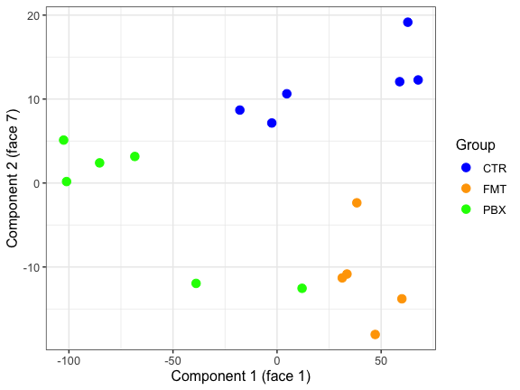
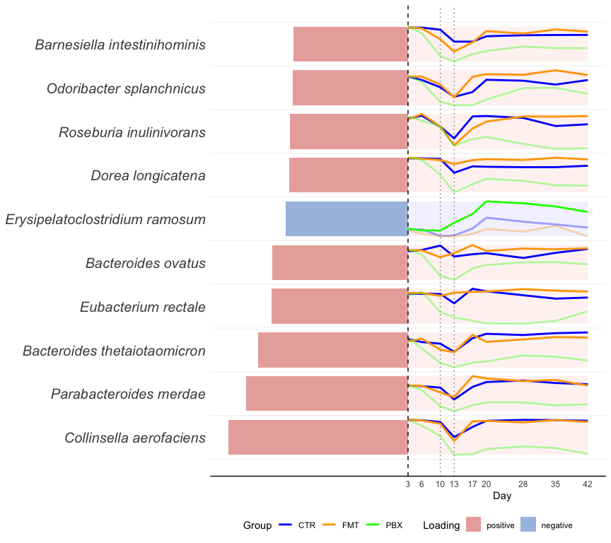
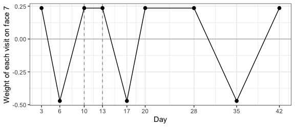
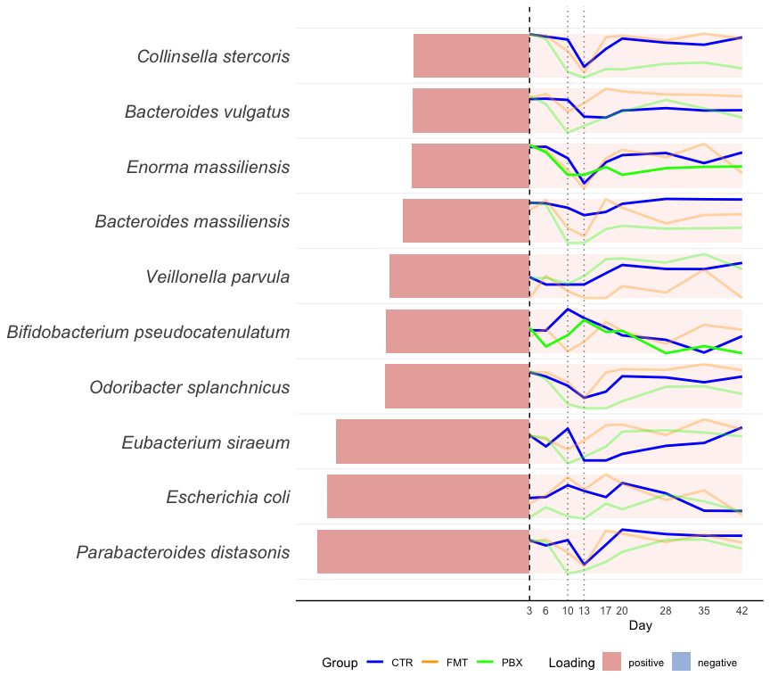

```{r setup, include=FALSE}
# The code chunks in this document are shown but not evaluated: see "Status of the
# software" below. The figures are the output of the development implementation and
# are included as images. Only the chunks that insert those images are evaluated.
knitr::opts_chunk$set(eval = FALSE, message = FALSE, warning = FALSE)
```

> ### Status of the software
>
> The results in this document were produced with the development implementation of the
> revised methods. Two packages are in progress: **`tensorOmics`** is being updated with
> the revised tensor PLS-DA, and **`tensorOmicsTools`**, which provides the plotting
> functions, is being implemented. The code shown below is the intended interface to
> those packages and **is not evaluated when this file is rendered**. The figures are the
> output of the development code, run on 15 October 2026. This vignette will be updated
> to run against both packages once they are released.

This document replaces the tensor PLS-DA section of `Case study 1.Rmd` and the biological
interpretation that follows it. The data, the preprocessing and the other methods in that
file are unchanged and are not repeated here.

# What changed

The method is the only change. The original analysis used the prior version of tPLS-DA.
The revised version differs in two ways:

- the subject-level outcome (the treatment group) is given to every time face, rather
  than being passed through the discrete cosine transform with the data, and
- the faces are scaled before one is chosen for each component.

A *face* is one term of the discrete cosine transform (DCT) along the nine visits. Face 1
is a taxon's average over the visits. Faces 2 to 9 describe changes across the visits,
from slow to fast. Each component is built on one face. The prior version could only use
face 1.

# Setup and data

```{r libraries}
library(tensorOmics)
library(tensorOmicsTools)
library(ggplot2)

# Log-fold change from each subject's own baseline, as in the original analysis.
load("data/antibioticStudy.Rdata")
```

The tensor is subjects × taxa × visits, 17 × 482 × 9, with three treatment groups: CTR
(spontaneous recovery), FMT (autologous faecal microbiota transplant) and PBX
(probiotics).

# tPLS-DA

```{r tplsda}
dct <- m_basis("dct", 9)

tplsda_res <- tplsda(
  logfold_array,
  group_vec,
  ncomp = 3,
  response = "untransformed",   # the group label reaches every face unchanged
  face_scaling = "frobenius",   # face scaling on
  y_deflation = "global"
)

# The face each component was built on
data.frame(component = 1:3, face = tplsda_res$faces)
```

Component 1 is on face 1, as in the original analysis. Component 2 is on face 7 and
component 3 on face 8, both fast-changing terms that the prior version could not reach.

## Sample plot

```{r sample-plot-code}
sample_plot(tplsda_res, group_vec)
```

```{r sample-plot-fig, eval=TRUE, echo=FALSE, out.width="70%", fig.align="center"}

```

Component 1 separates PBX from CTR and FMT, and component 2 separates CTR from FMT.
Component 1 is the same as with the prior version. Component 2 shows the same group
contrast as before, but it is built from different taxa and a different time pattern.

These are fitted scores. The group labels were used to build the components, and there
are 482 taxa for 17 subjects, so the separation shown here is expected and is not
evidence of prediction. In subject-level cross-validation (3-fold, repeated 10 times) the
revised version has a balanced error rate of 0.564 (lower is better; 0 is perfect),
against 0.671 with shuffled labels (p = 0.16).

---

# Biological interpretation

Each row of a loading plot is one of the ten taxa with the largest absolute loading on the
component, the largest at the bottom.

- **Left of the dashed line**: the length of the bar is the absolute loading and its
  colour is the sign of the loading.
- **Right of the dashed line**: the mean log-fold change from baseline of the taxon, by
  group and day, rescaled within each taxon to fill its row. The groups drawn in full
  colour are those in which the taxon's coefficient on the component's face is above the
  average over all subjects, and the others are faded. On face 1 those are the groups with
  the higher log-fold change averaged over the visits. The dotted lines mark the two days
  of antibiotics (days 10 and 13).

## Component 1: PBX against CTR and FMT

Component 1 separates PBX (negative side) from CTR and FMT (positive side). It is on face
1, so it contrasts the groups on each taxon's log-fold change averaged over the nine
visits.

```{r comp1-code}
loading_plot(tplsda_res, comp = 1, logfold_array, group_vec, days, taxa)
```

```{r comp1-fig, eval=TRUE, echo=FALSE, out.width="90%", fig.align="center"}

```

**Key findings.** This component is identical to component 1 of the prior version, with
the same ten taxa in the same order, so the findings below are unchanged from the original
analysis.

- **Elevated in PBX**: only *Erysipelatoclostridium ramosum* showed higher abundance in
  PBX. Independent studies have reported enrichment of this species after probiotic
  intervention.
- **Elevated in CTR and FMT**: the remaining top taxa were more abundant in the control
  and FMT groups, including *Parabacteroides merdae*, *Bacteroides thetaiotaomicron*,
  *Bacteroides ovatus* (linked to bile acid metabolism), *Dorea longicatena*, *Roseburia
  inulinivorans* and *Collinsella aerofaciens* (associated with beneficial recovery). Five
  of these taxa were previously identified as predictive recovery-associated species.

"More abundant" here means a smaller drop from baseline. In the group profiles these taxa
stay well below baseline in PBX after antibiotics, while in CTR and FMT they return
towards baseline.

## Component 2: CTR against FMT

**This section has changed.** With the prior version, component 2 was also on face 1 and
highlighted *Flavonifractor plautii* (higher in CTR), *Coprococcus eutactus* and
*Bacteroides dorei* (higher in FMT). None of those three is among the top ten taxa of the
revised component 2.

The revised component 2 separates CTR (positive side) from FMT (negative side), with PBX
in between. It is on face 7.

```{r face-weights-code}
ggplot(data.frame(day = days, weight = dct[tplsda_res$faces[2], ]), aes(day, weight)) +
  geom_hline(yintercept = 0, colour = "grey70") +
  geom_vline(xintercept = c(10, 13), linetype = "dashed", colour = "grey60") +
  geom_line() + geom_point(size = 2) +
  scale_x_continuous(breaks = days) +
  labs(x = "Day", y = sprintf("Weight of each visit on face %d", tplsda_res$faces[2])) +
  theme_bw()
```

```{r face-weights-fig, eval=TRUE, echo=FALSE, out.width="60%", fig.align="center"}

```

Face 7 is not an average. It compares days 6, 17 and 35 (negative weights) with the other
six visits (positive weights). A taxon has a positive loading on this component when that
contrast is larger in CTR than in FMT.

```{r comp2-code}
loading_plot(tplsda_res, comp = 2, logfold_array, group_vec, days, taxa)
```

```{r comp2-fig, eval=TRUE, echo=FALSE, out.width="90%", fig.align="center"}

```

**Key findings.** All ten top taxa have a positive loading: *Parabacteroides distasonis*,
*Escherichia coli*, *Eubacterium siraeum*, *Odoribacter splanchnicus*, *Bifidobacterium
pseudocatenulatum*, *Veillonella parvula*, *Bacteroides massiliensis*, *Enorma
massiliensis*, *Bacteroides vulgatus* and *Collinsella stercoris*.

For about half of them, the group profiles show the same picture at day 17, the first
visit after antibiotics: the taxon is close to its baseline level in FMT and still below it
in CTR. *E. siraeum*, *O. splanchnicus*, *B. vulgatus* and *C. stercoris* show this at day
17 and again at day 35, and *P. distasonis* at day 17 only. This would fit a faster return
to baseline after autologous FMT than with spontaneous recovery. The other five do not
show that picture; *Veillonella parvula*, for example, is lower in FMT than in CTR at
almost every visit, baseline included.

**Cautions.** Three things limit how far this component should be read.

- Face 7 is a fixed cosine pattern over the visit number. It also weights day 6, a
  baseline visit, and it treats the visits as evenly spaced, which they are not. The
  reading above therefore describes part of what the component uses, not all of it.
- The choice of face 7 is not stable. When one subject is left out and the model refitted,
  component 2 stays on face 7 in 10 of 17 refits.
- No literature has been checked for these ten taxa.

## Component 3

Component 3 is on face 8, another fast-changing term. It is the least stable of the three,
keeping its face in 6 of 17 leave-one-subject-out refits, and is not interpreted here. The
original analysis did not interpret component 3 either.
