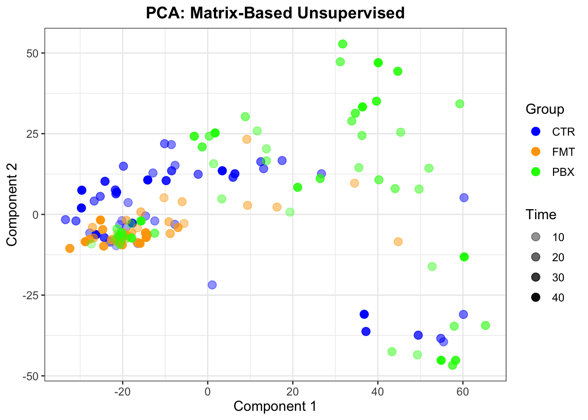
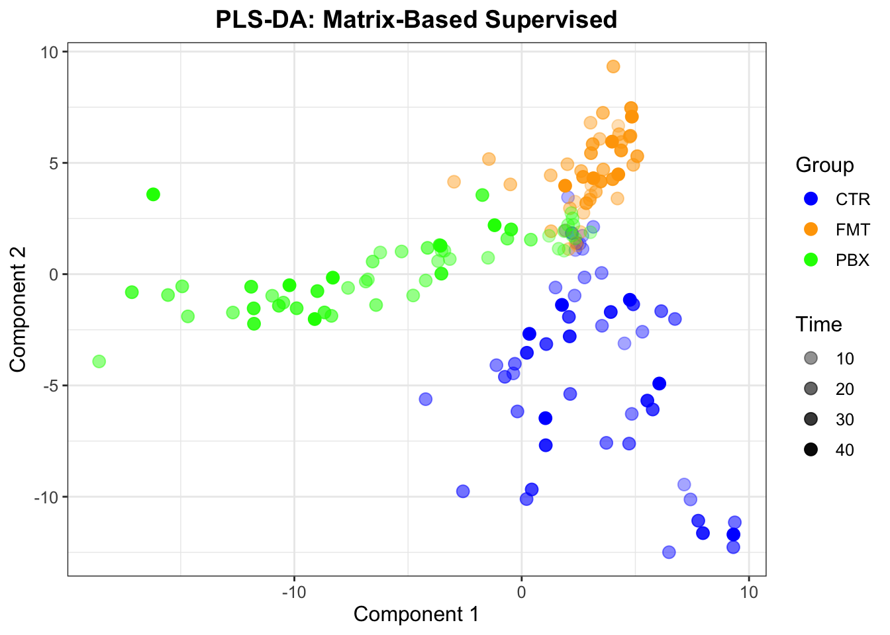
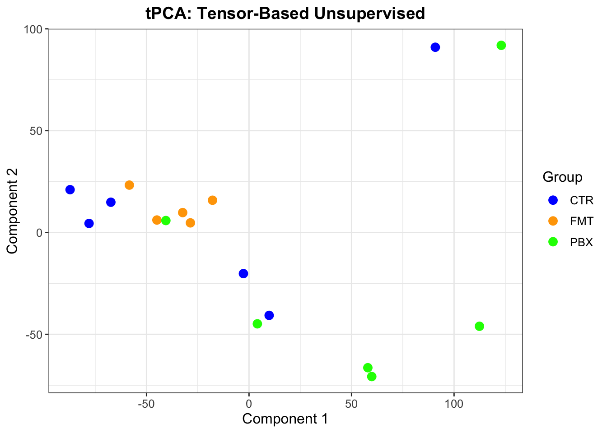
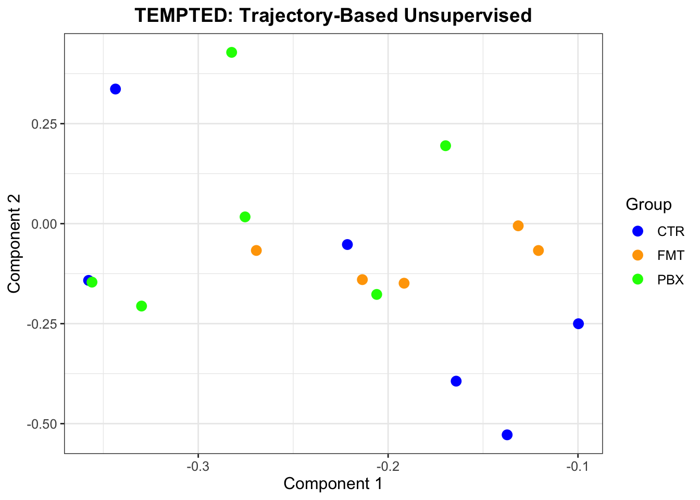

```{r setup, include=FALSE}
# The code chunks in this document are shown but not evaluated: see "Status of the
# software and of the results" below. Every figure is included as an image. Only the
# chunks that insert those images are evaluated.
knitr::opts_chunk$set(eval = FALSE, echo = TRUE, message = FALSE, warning = FALSE)
```

> ### Status of the software and of the results
>
> This vignette combines two sets of results.
>
> - The **comparison methods** (PCA, PLS-DA, tPCA, TEMPTED) are unchanged from the
>   original analysis. Their figures are the output of that analysis, run with the
>   released packages.
> - The **tPLS-DA** sections have been updated for the revision. Their figures are the
>   output of the development implementation, run on 15 October 2026.
>
> Two packages are in progress: **`tensorOmics`** is being updated with the revised
> tensor PLS-DA, and **`tensorOmicsTools`**, which provides the plotting functions, is
> being implemented. **The code chunks below are shown but not evaluated when this file
> is rendered**, and every figure is included as an image. This vignette will be updated
> to run end to end once both packages are released.

# Introduction

In this vignette, we will explore how supervised tensor analysis can enhance group separation in longitudinal microbiome data from an antibiotic study in @suez2018post. This study examined the microbiome recovery after a seven day antibiotic course. Participants were randomised to three groups: spontaneous recovery (CTR), autologous faecal microbiota transplantation (FMT), and commercial probiotics (PBX). The microbial composition was profiled across 42 days at multiple time points per participant.

Standard multivariate methods flatten the data into matrices and treat repeated measurements as independent samples. This structure obscures temporal information and amplifies inter-individual variation. Tensor approaches resolve this issue by modelling subjects, features, and time jointly.

In this vignette, we compare:

- PCA (unsupervised, matrix-based)

- PLS-DA (supervised, matrix-based)

- tPCA (unsupervised, tensor-based)

- TEMPTED (unsupervised trajectory analysis)

- tPLS-DA (supervised, tensor-based)

We focus on how each method represents longitudinal data and how supervised tensor loadings help interpret discriminatory microbial signatures.

---

# Setup and Data Loading

## Load Required Libraries

```{r libraries}
library(mixOmics)
library(tensorOmics)
library(tensorOmicsTools)
library(dplyr)
library(tidyr)
library(ggplot2)
library(tempted)

# Define color scheme for groups
custom_colors <- c("CTR" = "blue", "FMT" = "orange", "PBX" = "green")
```

## Load and Prepare Data

In the original study, operational taxonomic units (OTUs) with relative abundances below $0.1\%$ were removed, and samples were rarefied to a sequencing depth of 10,000 reads. Here, we used the normalised dataset provided in TCAM [@mor2022dimensionality], which applied log-fold baseline normalisation prior to analysis.

```{r load-data}
# Load log fold change data
load("data/antibioticStudy.Rdata")

# Set group as factor and sort
merged_df$rGroup <- as.factor(merged_df$rGroup)
merged_df <- merged_df %>%
  arrange(rGroup, Participant, rDay)

subjects <- unique(merged_df$Participant)

# Data dimensions
n <- length(unique(subjects))        # Number of subjects
p <- ncol(merged_df) - 6             # Number of taxa
t <- length(unique(merged_df$rDay))  # Number of time points
```

The data comprise 17 subjects, 482 taxa and 9 time points.

## Create Tensor Representation

```{r create-tensor}
# Create group vector (one per subject, correct order)
group_vec <- merged_df %>%
  distinct(Participant, rGroup) %>%
  arrange(match(Participant, subjects)) %>%
  pull(rGroup)

group_vec <- factor(group_vec)

# Initialize arrays for tensor representation
logfold_array <- array(0, dim = c(n, p, t))

# Fill arrays with data for each time point
for (i in 1:t) {
  day <- unique(merged_df$rDay)[i]
  indiv_index <- which(merged_df$rDay == day)

  logfold_array[, , i] <- as.matrix(merged_df[indiv_index, -c(1:6)])
}

days <- sort(unique(merged_df$rDay))
taxa <- gsub("_", " ", sub("^s__", "", colnames(merged_df)[-c(1:6)]))
```

Tensor structure: subjects × taxa × time = 17 × 482 × 9.

---

# Method Comparisons

## Matrix-Based Methods

### PCA: Unsupervised Matrix Approach

PCA treats each time point from each participant as an independent sample, resulting in participants appearing multiple times in the ordination space.

```{r pca}
# Prepare feature table (matrix format)
feature_table <- merged_df[, -c(1:6)]
rownames(feature_table) <- paste(merged_df$Participant, merged_df$rDay, sep = "_")
time_point <- merged_df$rDay

# Run PCA
pca_res <- pca(feature_table, ncomp = 2)

# Create results dataframe
res_df <- data.frame(
  Group = merged_df$rGroup,
  Time = time_point,
  PC1 = pca_res$variates$X[, 1],
  PC2 = pca_res$variates$X[, 2]
)

# Visualize
ggplot(res_df, aes(x = PC1, y = PC2, color = Group, alpha = Time)) +
  geom_point(size = 3) +
  ggtitle("PCA: Matrix-Based Unsupervised") +
  theme_bw() +
  scale_color_manual(values = custom_colors) +
  scale_alpha(range = c(0.3, 1)) +
  xlab("Component 1") +
  ylab("Component 2") +
  theme(
    plot.title = element_text(hjust = 0.5, size = 14, face = "bold"),
    text = element_text(size = 12),
    legend.position = "right"
  )
```

```{r pca-fig, eval=TRUE, echo=FALSE, out.width="75%", fig.align="center"}

```

**Results**: PCA did not separate the three treatment groups. The ordination was dominated by strong inter-individual variability, with time points from the same participant scattered throughout the space.

### PLS-DA: Supervised Matrix Approach

PLS-DA incorporates treatment group information but still treats repeated observations as independent.

```{r plsda}
# Run PLS-DA
plsda_res <- plsda(feature_table, merged_df$rGroup, ncomp = 2)

# Create results dataframe
res_df <- data.frame(
  Group = merged_df$rGroup,
  Time = time_point,
  PC1 = plsda_res$variates$X[, 1],
  PC2 = plsda_res$variates$X[, 2]
)

# Visualize
ggplot(res_df, aes(x = PC1, y = PC2, color = Group, alpha = Time)) +
  geom_point(size = 3) +
  ggtitle("PLS-DA: Matrix-Based Supervised") +
  theme_bw() +
  scale_color_manual(values = custom_colors) +
  scale_alpha(range = c(0.3, 1)) +
  xlab("Component 1") +
  ylab("Component 2") +
  theme(
    plot.title = element_text(hjust = 0.5, size = 14, face = "bold"),
    text = element_text(size = 12),
    legend.position = "right"
  )
```

```{r plsda-fig, eval=TRUE, echo=FALSE, out.width="75%", fig.align="center"}

```

**Results**: PLS-DA produced clearer separation between groups compared to PCA. However, it still violates the repeated-measures structure by treating observations from the same individual as independent.

---

## Tensor-Based Methods

### tPCA: Unsupervised Tensor Approach

tPCA represents each participant by a single point corresponding to their full temporal trajectory.

```{r tpca}
# Run tPCA
tpca_res <- tpca(logfold_array, ncomp = 3)

# Create results dataframe
res_df <- data.frame(
  Group = group_vec,
  PC1 = tpca_res$variates[, 1],
  PC2 = tpca_res$variates[, 2],
  PC3 = tpca_res$variates[, 3]
)
rownames(res_df) <- unique(merged_df$Participant)

# Visualize
ggplot(res_df, aes(x = PC1, y = PC2, color = Group)) +
  geom_point(size = 3) +
  ggtitle("tPCA: Tensor-Based Unsupervised") +
  theme_bw() +
  scale_color_manual(values = custom_colors) +
  xlab("Component 1") +
  ylab("Component 2") +
  theme(
    plot.title = element_text(hjust = 0.5, size = 14, face = "bold"),
    text = element_text(size = 12),
    legend.position = "right"
  )
```

```{r tpca-fig, eval=TRUE, echo=FALSE, out.width="75%", fig.align="center"}

```

**Results**: tPCA correctly represents each subject as a single point (no duplication), preserving temporal structure. However, like unsupervised PCA, it did not fully differentiate treatment groups, primarily capturing subject-specific variation.

### TEMPTED: Trajectory-Based Analysis

TEMPTED extracts smoothed temporal factors but does not use group labels.

```{r tempted}
# Run TEMPTED
subject_id <- merged_df$Participant

res_count <- tempted_all(
  feature_table,
  time_point,
  subject_id,
  threshold = 0.95,
  transform = "none",
  pseudo = 0.5,
  r = 2,
  smooth = 1e-5,
  pct_ratio = 0.1,
  pct_aggregate = 1
)

# Create results dataframe
res_df <- data.frame(
  Group = group_vec,
  PC1 = res_count$A_hat[, 1],
  PC2 = res_count$A_hat[, 2]
)
rownames(res_df) <- unique(merged_df$Participant)

# Visualize
ggplot(res_df, aes(x = PC1, y = PC2, color = Group)) +
  geom_point(size = 3) +
  ggtitle("TEMPTED: Trajectory-Based Unsupervised") +
  theme_bw() +
  scale_color_manual(values = custom_colors) +
  xlab("Component 1") +
  ylab("Component 2") +
  theme(
    plot.title = element_text(hjust = 0.5, size = 14, face = "bold"),
    text = element_text(size = 12),
    legend.position = "right"
  )
```

```{r tempted-fig, eval=TRUE, echo=FALSE, out.width="75%", fig.align="center"}

```

**Results**: TEMPTED summarized global temporal variation but did not separate treatment groups. Like tPCA, the embedding remained dominated by inter-individual structure.

---

### tPLS-DA: Supervised Tensor Approach

> The remainder of this vignette has been **updated for the revision**. The figures below
> are the output of the revised tPLS-DA, not of the version used in the original
> analysis.

tPLS-DA integrates treatment information while modelling data as a tensor, preserving within-subject temporal structure. The revised version differs from the original in two ways:

- the subject-level outcome (the treatment group) is given to every time face, rather than
  being passed through the discrete cosine transform with the data, and
- the faces are scaled before one is chosen for each component.

A *face* is one term of the discrete cosine transform (DCT) along the nine visits. Face 1 is a taxon's average over the visits. Faces 2 to 9 describe changes across the visits, from slow to fast. Each component is built on one face. The original version could only use face 1.

```{r tplsda}
dct <- m_basis("dct", 9)

tplsda_res <- tplsda(
  logfold_array,
  group_vec,
  ncomp = 3,
  response = "untransformed",   # the group label reaches every face unchanged
  face_scaling = "frobenius",   # face scaling on
  y_deflation = "global"
)

# The face each component was built on
data.frame(component = 1:3, face = tplsda_res$faces)
```

Component 1 is on face 1, as in the original analysis. Component 2 is on face 7 and component 3 on face 8, both fast-changing terms that the original version could not reach.

```{r tplsda-sample-code}
sample_plot(tplsda_res, group_vec)
```

```{r tplsda-sample-fig, eval=TRUE, echo=FALSE, out.width="70%", fig.align="center"}
knitr::include_graphics("figures/tplsda-sample-plot-1.png")
```

**Results**: component 1 separates PBX from CTR and FMT, and component 2 separates CTR from FMT. Component 1 is the same as in the original analysis. Component 2 shows the same group contrast as before, but it is built from different taxa and a different time pattern.

These are fitted scores. The group labels were used to build the components, and there are 482 taxa for 17 subjects, so the separation shown here is expected and is not evidence of prediction. In subject-level cross-validation (3-fold, repeated 10 times) the revised version has a balanced error rate of 0.564 (lower is better; 0 is perfect), against 0.671 with shuffled labels (p = 0.16).

---

# Biological Interpretation

Each row of a loading plot is one of the ten taxa with the largest absolute loading on the component, the largest at the bottom.

- **Left of the dashed line**: the length of the bar is the absolute loading and its colour is the sign of the loading.
- **Right of the dashed line**: the mean log-fold change from baseline of the taxon, by group and day, rescaled within each taxon to fill its row. The groups drawn in full colour are those in which the taxon's coefficient on the component's face is above the average over all subjects, and the others are faded. On face 1 those are the groups with the higher log-fold change averaged over the visits. The dotted lines mark the two days of antibiotics (days 10 and 13).

## Component 1: PBX against CTR and FMT

Component 1 separates PBX (negative side) from CTR and FMT (positive side). It is on face 1, so it contrasts the groups on each taxon's log-fold change averaged over the nine visits.

```{r comp1-code}
loading_plot(tplsda_res, comp = 1, logfold_array, group_vec, days, taxa)
```

```{r comp1-fig, eval=TRUE, echo=FALSE, out.width="90%", fig.align="center"}
knitr::include_graphics("figures/comp1-loading-1.png")
```

**Key findings.** This component is identical to component 1 of the original version, with the same ten taxa in the same order, so the findings below are unchanged from the original analysis.

- **Elevated in PBX**: only *Erysipelatoclostridium ramosum* showed higher abundance in PBX. Independent studies have reported enrichment of this species after probiotic intervention.
- **Elevated in CTR and FMT**: the remaining top taxa were more abundant in the control and FMT groups, including *Parabacteroides merdae*, *Bacteroides thetaiotaomicron*, *Bacteroides ovatus* (linked to bile acid metabolism), *Dorea longicatena*, *Roseburia inulinivorans* and *Collinsella aerofaciens* (associated with beneficial recovery). Five of these taxa were previously identified as predictive recovery-associated species.

"More abundant" here means a smaller drop from baseline. In the group profiles these taxa stay well below baseline in PBX after antibiotics, while in CTR and FMT they return towards baseline.

## Component 2: CTR against FMT

**This section has changed.** With the original version, component 2 was also on face 1 and highlighted *Flavonifractor plautii* (higher in CTR), *Coprococcus eutactus* and *Bacteroides dorei* (higher in FMT). None of those three is among the top ten taxa of the revised component 2.

The revised component 2 separates CTR (positive side) from FMT (negative side), with PBX in between. It is on face 7.

```{r face-weights-code}
ggplot(data.frame(day = days, weight = dct[tplsda_res$faces[2], ]), aes(day, weight)) +
  geom_hline(yintercept = 0, colour = "grey70") +
  geom_vline(xintercept = c(10, 13), linetype = "dashed", colour = "grey60") +
  geom_line() + geom_point(size = 2) +
  scale_x_continuous(breaks = days) +
  labs(x = "Day", y = sprintf("Weight of each visit on face %d", tplsda_res$faces[2])) +
  theme_bw()
```

```{r face-weights-fig, eval=TRUE, echo=FALSE, out.width="60%", fig.align="center"}
knitr::include_graphics("figures/face-weights-1.png")
```

Face 7 is not an average. It compares days 6, 17 and 35 (negative weights) with the other six visits (positive weights). A taxon has a positive loading on this component when that contrast is larger in CTR than in FMT.

```{r comp2-code}
loading_plot(tplsda_res, comp = 2, logfold_array, group_vec, days, taxa)
```

```{r comp2-fig, eval=TRUE, echo=FALSE, out.width="90%", fig.align="center"}
knitr::include_graphics("figures/comp2-loading-1.png")
```

**Key findings.** All ten top taxa have a positive loading: *Parabacteroides distasonis*, *Escherichia coli*, *Eubacterium siraeum*, *Odoribacter splanchnicus*, *Bifidobacterium pseudocatenulatum*, *Veillonella parvula*, *Bacteroides massiliensis*, *Enorma massiliensis*, *Bacteroides vulgatus* and *Collinsella stercoris*.

For about half of them, the group profiles show the same picture at day 17, the first visit after antibiotics: the taxon is close to its baseline level in FMT and still below it in CTR. *E. siraeum*, *O. splanchnicus*, *B. vulgatus* and *C. stercoris* show this at day 17 and again at day 35, and *P. distasonis* at day 17 only. This would fit a faster return to baseline after autologous FMT than with spontaneous recovery. The other five do not show that picture; *Veillonella parvula*, for example, is lower in FMT than in CTR at almost every visit, baseline included.

**Cautions.** Three things limit how far this component should be read.

- Face 7 is a fixed cosine pattern over the visit number. It also weights day 6, a baseline visit, and it treats the visits as evenly spaced, which they are not. The reading above therefore describes part of what the component uses, not all of it.
- The choice of face 7 is not stable. When one subject is left out and the model refitted, component 2 stays on face 7 in 10 of 17 refits.
- No literature has been checked for these ten taxa.

## Component 3

Component 3 is on face 8, another fast-changing term. It is the least stable of the three, keeping its face in 6 of 17 leave-one-subject-out refits, and is not interpreted here. The original analysis did not interpret component 3 either.

---

# Summary and Conclusions

## Method Performance

<div style="display: flex; justify-content: center;">

| Method | Supervision | Temporal Structure | Group Separation |
|:--------:|:-----------:|:-----------------:|:----------------:|
| PCA | No | No | Moderate |
| PLS-DA | **Yes** | No | **Good** |
| tPCA | No | **Yes** | Moderate |
| TEMPTED | No | **Yes** | Moderate |
| **tPLS-DA** | **Yes** | **Yes** | **Good** |

</div>

## Key Takeaways

1. **Unsupervised methods** (PCA, tPCA, TEMPTED) failed to separate treatment groups, being dominated by inter-individual variation.

2. **Matrix-based supervised analysis** (PLS-DA) improved separation but violated the repeated-measures structure.

3. **Tensor-based supervised analysis** (tPLS-DA) provided the best results by:
   - Preserving within-subject temporal structure
   - Incorporating treatment information
   - Producing biologically interpretable loadings

4. **Biological interpretation**: component 1 identified recovery-associated taxa in the CTR and FMT groups and probiotic-specific enrichment in PBX, consistent with published literature. Component 2 separates CTR from FMT on a fast-changing temporal pattern; its reading is provisional, for the reasons given above.

5. The separation in the sample plots is fitted, not predicted. With 17 subjects and 482 taxa, held-out classification is the relevant measure, and it is weak (balanced error rate 0.564 against 0.671 for shuffled labels, p = 0.16).

## Recommendations

For longitudinal microbiome studies with treatment groups:

- **Use tPLS-DA** when group discrimination is the primary goal
- **Combine with tPCA** for exploratory analysis
- Report held-out performance alongside the fitted sample plots

---

# References
