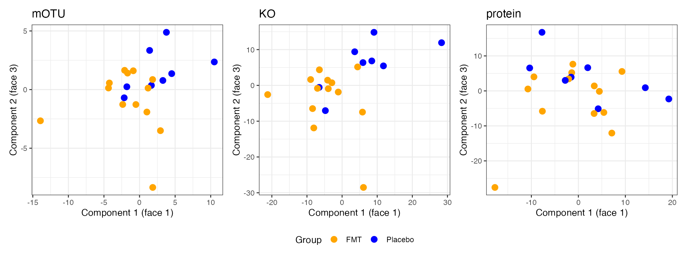
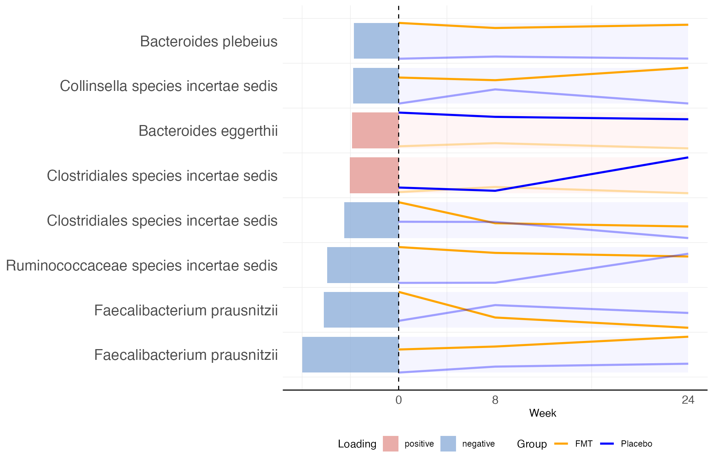
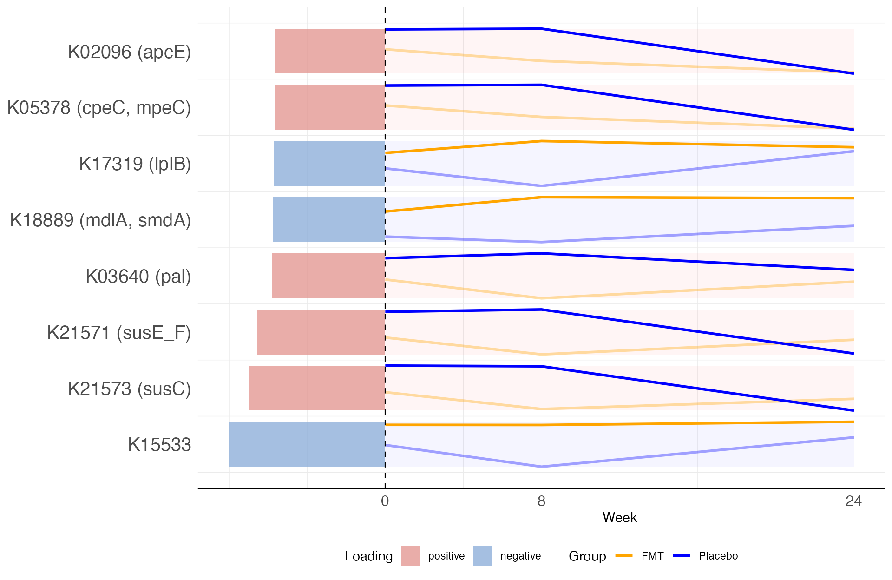
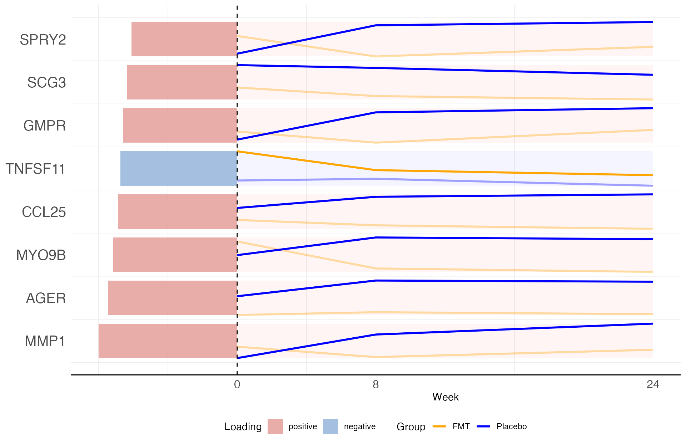
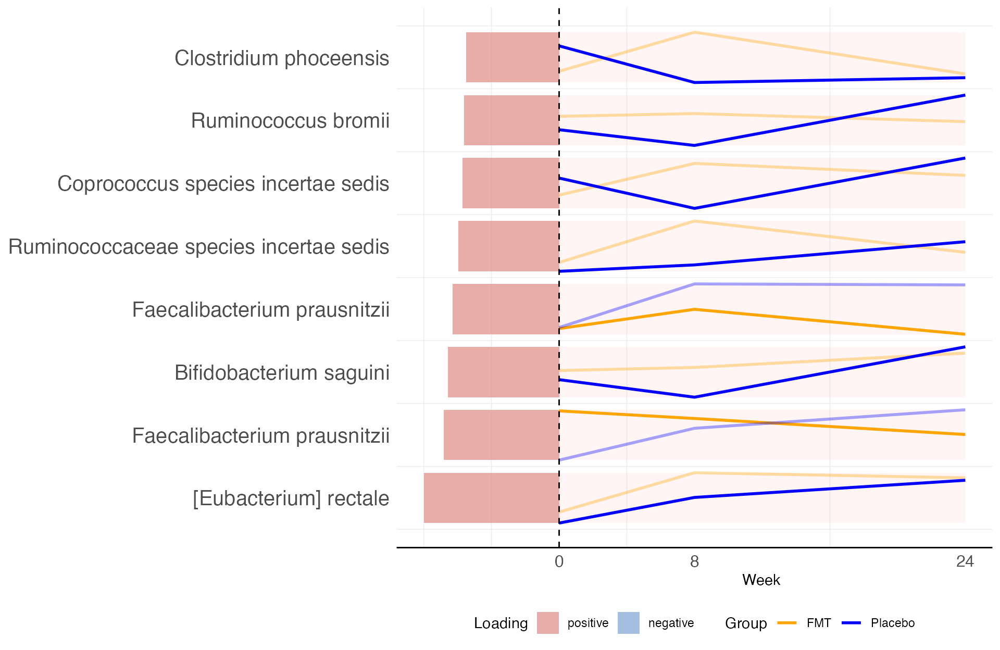
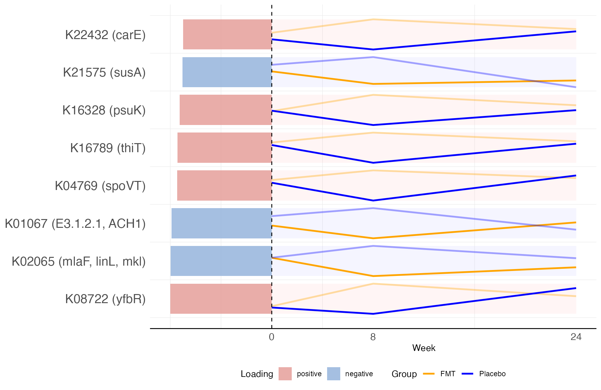

```{r setup, include=FALSE}
# The code chunks in this document are shown but not evaluated: see "Status of the
# software and of the results" below. Every figure is included as an image. Only the
# chunks that insert those images are evaluated.
knitr::opts_chunk$set(eval = FALSE, echo = TRUE, message = FALSE, warning = FALSE)
```

*Software note. The results presented here were generated with the development version of
`tensorOmics`, which implements the updated block.tPLS-DA described in the revised
manuscript (October 2026). The accompanying plotting functions are being packaged as
`tensorOmicsTools`, and both are being prepared for release. Code is shown throughout for
reference; the analysis chunks are not evaluated when this file is rendered, and the figures
and reported values are pre-computed from the development version. The vignette will be
updated to run against the released packages once they are available. The preprocessing
(`1. Preprocessing.R`) and the batch-effect correction (`2. Batch_effect.R`) are
unchanged.*

# Introduction

In this vignette, we demonstrate how multiblock tensor Partial Least Squares Discriminant Analysis (block.tPLS-DA) enables longitudinal multi-omic integration by analyzing metagenomic, functional, and proteomic data from a fecal microbiota transplantation (FMT) study [@diaz2024fecal]. This study examined the effects of FMT versus placebo treatment using a comprehensive multi-block temporal framework.

## Study Design

The study examined patients receiving either FMT or placebo treatment:

- **FMT group**: Patients receiving fecal microbiota transplantation
- **Placebo group**: Control patients
- **Data blocks**: Three complementary omic layers
  - mOTUs (metagenomic operational taxonomic units)
  - KO (KEGG orthology functional annotations)
  - Proteins (host protein expression profiles)
- **Temporal design**: Three time points (Weeks 0, 8, 24)

Participants received FMT or placebo capsules weekly for eight weeks, so the week 8 visit marks the end of dosing and the week 24 visit is 16 weeks after the last dose.

## Data Preprocessing

mOTUs, KOs, and proteins whose total abundance contributed less than $0.01\%$ of the overall signal were removed. A centered log-ratio (CLR) transformation with a pseudocount of one was applied to the mOTU data, and the KO abundance matrix was log-transformed with a pseudocount of one to stabilise variance and reduce the influence of extreme values. For the protein data, features were scaled following the normalisation procedure described by @diaz2024fecal.

## Analysis Goal

We use block.tPLS-DA to simultaneously integrate three longitudinal omic layers while preserving temporal structure and maximizing discrimination between treatment groups. This analysis aims to identify:

1. How FMT treatment effects manifest across taxonomic, functional, and protein layers
2. Which features drive treatment discrimination in each data block

## What changed in the revision

Two things changed from the original analysis.

**The method.** The revised block.tPLS-DA gives the subject-level outcome to every time face rather than passing it through the discrete cosine transform with the data, and scales the faces before one is chosen for each component. A *face* is one term of the discrete cosine transform along the three visits:

| face | what it is | what a difference on it means |
|---|---|---|
| 1 | the average over weeks 0, 8 and 24 | a difference between the arms that is present throughout, including at baseline |
| 2 | week 0 minus week 24 | a net change over the study |
| 3 | weeks 0 and 24 against week 8 | a difference at the end of dosing that has receded 16 weeks later |

In the submitted version the treatment outcome was transformed along with the data, so it
contributed on face 1 only. With positive block-to-block weights a component could still be
built on another face, through the covariance among the omic blocks, but such a selection
carried no link between that temporal face and treatment. Giving the untransformed outcome to
every face is what allows a component to be built on a temporal pattern that discriminates the
treatment arms.

**The design matrix.** The revised analysis uses a weight of 1 between every pair of omic blocks and between every block and the treatment group. The original analysis used 0.1 between the omic blocks. Results at 0.1 are reported in the Supplementary Material.

---

```{r visualizations-info, eval=TRUE, echo=FALSE, results='asis'}
cat('
<div style="background-color: #f0f8ff; border-left: 5px solid #4682b4; padding: 15px; margin: 20px 0; border-radius: 5px;">

<strong style="color: #2c5282; font-size: 16px;">Understanding the Visualizations</strong>

<p>This vignette uses two complementary visualization types:</p>

<strong style="color: #2c5282;">Sample Plots (Score Plots)</strong>

<ul>
<li><strong>Each point</strong> represents a patient\'s complete temporal trajectory across all three time points</li>
<li><strong>Distance between points</strong> reflects similarity in multi-omic profiles</li>
<li><strong>Axes (Components)</strong>: each axis represents a latent component, built on one temporal face</li>
<li><strong>Color coding</strong>: FMT = orange, Placebo = blue</li>
</ul>

<strong style="color: #2c5282;">Loading Plots (Feature Contribution Plots)</strong>

<p>Each row is one of the eight features with the largest absolute loading, the largest at the bottom.</p>

<ul>
<li><strong>Left of the dashed line</strong>: the length of the bar is the absolute loading and its colour is the sign of the loading (pink positive, blue negative).</li>

<li><strong>Right of the dashed line</strong>: the group means of the feature at each visit, rescaled within the feature to fill its row, so a row shows the shape of the two profiles and not their level. The group drawn in full colour is the one with the larger coefficient on the component\'s face; the other is faded.</li>
</ul>

<p><strong>Interpretation:</strong> on face 1 the group in full colour is the one with the higher value averaged over the three visits. On another face the meaning follows that face, and is stated in the text for each component.</p>

</div>
')
```

---

# Setup and Data Loading

```{r libraries}
library(tensorOmics)
library(tensorOmicsTools)

# Batch-corrected mOTU and KO arrays, and the protein array, from 2. Batch_effect.R
load("data_filtered/fmtStudy_noBatch.RData")
```

Each omic layer is its own third-order tensor of subjects × features × visits: 21 × 1,077 × 3 for mOTUs, 21 × 1,337 × 3 for KOs and 21 × 194 × 3 for proteins.

```{r design-matrix}
# Rows and columns: mOTU, KO, protein, treatment group
design <- matrix(1, 4, 4,
                 dimnames = rep(list(c("mOTU", "KO", "Protein", "Group")), 2))
diag(design) <- 0
design
```

---

# Multiblock Tensor PLS-DA Analysis

```{r block-tplsda}
# Discrete cosine basis along the three visits
dct <- m_basis("dct", 3)

# Development implementation of the revised block.tPLS-DA. The two settings written out
# below are what distinguish it from the submitted version, and are its defaults:
#   response = "untransformed"  the treatment outcome reaches every face unchanged
#   face_scaling = "frobenius"  faces are scaled before one is chosen per component
tblockplsda_res <- block_tplsda_ref(
  list(mOTU = mic_nobatch_array, KO = ko_nobatch_array, Protein = prot_array),
  subject_info$Group,
  dct,
  ncomp = 3,
  design = design,
  response = "untransformed",
  face_scaling = "frobenius"
)

# The face each component was built on
data.frame(component = 1:3, face = tblockplsda_res$faces)
```

Component 1 is on face 1, the average over the three visits, as in the original analysis. Component 2 is on face 3, the contrast between week 8 and the other two visits.

## Sample Plots

```{r sample-plots-code}
sample_plots(tblockplsda_res, subject_info$Group, c("mOTU", "KO", "Protein"))
```

```{r sample-plots-fig, eval=TRUE, echo=FALSE, out.width="100%", fig.align="center"}

```

FMT and placebo recipients are located on opposite sides of component 1 in all three blocks. Because the treatment groups are used to construct the components, the separation of the groups in these plots is expected, and it does not show by itself that the model would classify a new subject correctly. For the same reason we do not rank the three blocks by the visual separation of their score plots.

---

# Results and Interpretation

## Component 1

### Block 1: mOTU (Taxonomic Composition)

```{r comp1-motu-code}
loading_plot(tblockplsda_res, block = 1, comp = 1)
```

```{r comp1-motu-fig, eval=TRUE, echo=FALSE, out.width="95%", fig.align="center"}

```

FMT recipients had a higher average abundance of two *Faecalibacterium prausnitzii* mOTUs (Taxa1496, Taxa1492), a Ruminococcaceae species (Taxa1669), a Clostridiales species (Taxa950), a *Collinsella* species (Taxa133) and *Bacteroides plebeius* (Taxa232). *F. prausnitzii* is a butyrate-producing bacterium that has been consistently associated with intestinal health and has anti-inflammatory properties. Ruminococcaceae family members are important degraders of complex polysaccharides and producers of short-chain fatty acids. These taxa are in line with the design of the trial, in which the stool donors were selected for their high *Faecalibacterium* abundance and butyrate profiles, and with the engraftment of Ruminococcaceae and Lachnospiraceae that the trial reported.

Placebo recipients had a higher average abundance of a second Clostridiales species (Taxa880) and of *Bacteroides eggerthii* (Taxa224).

Because component 1 summarises the average over the three visits, it also carries differences that were present before treatment: *F. prausnitzii* (Taxa1496), for example, was already more abundant in FMT recipients at baseline.

> **Note on the row labels.** Taxa are named by species, without the mOTU number. Two
> taxa of the same species therefore carry the same label: *Faecalibacterium prausnitzii*
> appears twice (Taxa1496 and Taxa1492) and *Clostridiales* species incertae sedis
> appears twice (Taxa950 and Taxa880). The mOTU numbers are given in the text above.

### Block 2: KO (Functional Annotations)

```{r comp1-ko-code}
loading_plot(tblockplsda_res, block = 2, comp = 1)
```

```{r comp1-ko-fig, eval=TRUE, echo=FALSE, out.width="95%", fig.align="center"}

```

FMT recipients had a higher average abundance of 1,3-beta-galactosyl-N-acetylhexosamine phosphorylase (K15533), of the putative aldouronate transport system permease protein (K17319) and of an ATP-binding cassette multidrug efflux pump (K18889). The first two functions are involved in complex carbohydrate metabolism and nutrient transport.

Placebo recipients had a higher average abundance of the TonB-dependent starch-binding outer membrane protein SusC (K21573), the starch-binding outer membrane protein SusE/F (K21571) and the peptidoglycan-associated lipoprotein (K03640). SusC and SusE/F belong to the starch utilisation system, which is specific to the Gram-negative Bacteroidetes.

### Block 3: Protein (Host Response)

```{r comp1-protein-code}
loading_plot(tblockplsda_res, block = 3, comp = 1)
```

```{r comp1-protein-fig, eval=TRUE, echo=FALSE, out.width="95%", fig.align="center"}

```

Seven of the eight proteins with the largest loadings had a higher average level in placebo recipients: MMP1, AGER, MYO9B, CCL25, GMPR, SCG3 and SPRY2. They include the chemokine CCL25, the receptor for advanced glycation end-products (AGER) and the matrix metalloproteinase MMP1. For CCL25 and AGER, the difference between the groups widened after baseline: their levels decreased or remained low in FMT recipients and increased in placebo recipients. This direction agrees with the reduction of plasma inflammatory proteins after FMT reported for this trial. Only TNFSF11 had a higher average level in FMT recipients, and its level decreased over the study in that group.

---

## Component 2

Component 2 captured what distinguished the end of dosing from the other two visits. It is on face 3, so the group drawn in full colour is the one in which the feature is relatively lower at week 8.

### Block 1: mOTU

```{r comp2-motu-code}
loading_plot(tblockplsda_res, block = 1, comp = 2)
```

```{r comp2-motu-fig, eval=TRUE, echo=FALSE, out.width="95%", fig.align="center"}

```

The taxa with the largest loadings were members of the Lachnospiraceae (*Eubacterium rectale*, a *Coprococcus* species) and of the Ruminococcaceae (*Ruminococcus bromii*, *F. prausnitzii*). These families include major butyrate producers and, with *R. bromii*, a keystone degrader of resistant starch, and they are the families for which the trial reported a mild and transient engraftment during the treatment period. For several of these taxa, however, the contrast reflected a decrease in placebo recipients at week 8 as much as an increase in FMT recipients, so the taxonomic part of this component should be read with caution.

### Block 2: KO

```{r comp2-ko-code}
loading_plot(tblockplsda_res, block = 2, comp = 2)
```

```{r comp2-ko-fig, eval=TRUE, echo=FALSE, out.width="95%", fig.align="center"}

```

Several functions increased at week 8 in FMT recipients and decreased in placebo recipients, before both groups returned towards their baseline level at week 24. They included the sporulation regulator SpoVT (K04769); spore formation is widespread among the Firmicutes of the human gut. Functions that moved in the opposite direction included MlaF (K02065), part of the system that maintains the outer membrane of Gram-negative bacteria, and the neopullulanase SusA (K21575) of the starch utilisation system.

### A model-free check of the week 8 contrast

To examine this temporal pattern without relying on the fitted model, we compared the two groups directly at each visit, using the mean absolute difference between the group means over all the features of a block and a permutation of the group labels.

The functional profiles of the two groups differed more than expected at week 8 (p = 0.004; p = 0.036 after Bonferroni adjustment for the nine block-by-visit comparisons), and not at baseline or at week 24. The difference at week 8 was weaker in the taxonomic profiles (p = 0.09) and absent in the protein profiles. We therefore do not interpret the protein loadings of component 2, which were dominated by differences between the groups at baseline.

---

# Classification of Held-Out Subjects

Held-out performance was assessed with the benchmarking code accompanying the manuscript
(Section 2.5), which is not reproduced here: subject-level cross-validation with three folds
stratified by treatment, repeated 10 times, refitting the revised block.tPLS-DA within each
training fold with the settings shown above.

With the three blocks together, the balanced error rate was 0.266 (SD 0.065), against a median of 0.521 with permuted group labels (p = 0.03, not adjusted for multiple comparisons).

Without the batch correction of the mOTU and KO blocks, the error was 0.465 (SD 0.098) and did not differ from that of the permuted labels (p = 0.33). The classification therefore depends on the batch correction. That correction, PLSDA-batch, used the treatment labels of all the subjects, including those subsequently held out in each fold, so the error on the corrected data is optimistic. We verified that the correction did not change the mean of any feature in either group at any visit: it reduced the variation within the groups and left the differences between them as they were.

Among the three blocks, the scores of the KO block had the lowest error (0.263), followed by the mOTU block (0.414) and the protein block (0.459). These values measure how well the scores of each block discriminate held-out subjects, and not the contribution of each block to the joint model.

---

# Summary and Conclusions

## Key Findings

This case study illustrates how block.tPLS-DA integrates several longitudinal omic layers while retaining their temporal structure.

The first component summarised the differences between FMT and placebo recipients in the average over the visits: a higher abundance of butyrate-producing taxa such as *Faecalibacterium prausnitzii* and of functions of complex carbohydrate metabolism in FMT recipients, and higher levels of several plasma proteins, including CCL25 and AGER, in placebo recipients.

The second component pointed to a shift in microbial functions at the end of dosing that had receded 16 weeks later, in agreement with the transient engraftment reported for this trial.

## Biological Significance

The taxonomic and functional signatures are consistent with the design of the trial, in which stool donors were selected for high *Faecalibacterium* abundance and butyrate profiles, and with the reduction of plasma inflammatory proteins after FMT reported for this cohort.

## Limitations

With 21 subjects these results are exploratory. Held-out subjects were classified better than chance only after a batch correction that used the treatment labels, part of the differences summarised by component 1 was already present at baseline, and the features with the largest loadings changed when single subjects were left out.

---

# References
